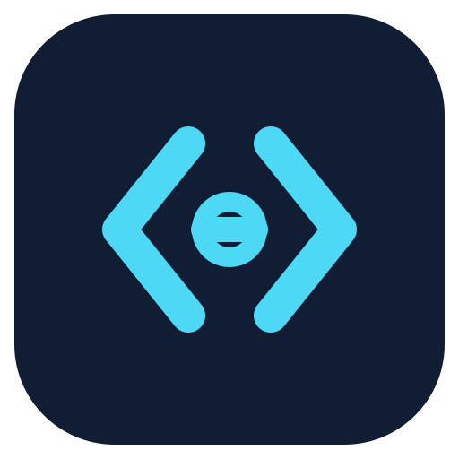

> **Independent community fork — TheerasakPing/ORG2**
>
> This repository is a fork of [org2AI/ORG2](https://github.com/org2AI/ORG2).
> Work-in-progress app identity: **TP Agent Studio** (provisional branding; legacy compatibility names remain in internal APIs).
>
> 
>
> Two-tone desktop branding details: [branding guide](docs/fork/TWO_TONE_BRANDING.md).
> This fork does **not** distribute the upstream publisher's installers.
> The fork's application updater is intentionally disabled pending independent signing and release infrastructure.
> **Do not install experimental fork builds alongside upstream ORG2** until the app identity,
> deep links and `~/.orgii` state/storage are isolated and migration-tested.
> See [FORK.md](FORK.md), [the fork roadmap](docs/fork/ROADMAP.md),
> [Cloud boundary audit](docs/fork/FORK_CLOUD_BOUNDARY.md) and [session-stall recovery](docs/fork/SESSION_STALL_RECOVERY.md).
>
> **Development status (17 October 2026):** changes are integrated on [PR #9](https://github.com/TheerasakPing/ORG2/pull/9)
> against `develop`, **not yet merged or released**. CI must pass on the final commit,
> including Rust on Windows/macOS, before the pull request is merged. Platform installer,
> co-installation, memory/restart stress and fork-owned Cloud/OAuth acceptance tests remain outstanding.

---

<div align="center">
  <h1>TP Agent Studio</h1>
  <p><strong>The system of record for how agents build software.<br />Run your coding agents — replay any session, review as a team, and trace every line back to the decision behind it.</strong></p>
</div>

---

> **No TP Agent Studio installers are published yet.** macOS Apple Silicon, Windows 11, and Linux builds are undergoing identity, data-isolation, CI and signing verification. See [release readiness](FORK.md) and [engineering roadmap](docs/fork/ROADMAP.md).
---

<p align="center">
  <a href="README.md">English</a> · <a href="docs/readmes/README.fr.md">Français</a> · <a href="docs/readmes/README.zh.md">简体中文</a> · <a href="docs/readmes/README.zh-Hant.md">繁體中文</a> · <a href="docs/readmes/README.es.md">Español</a> · <a href="docs/readmes/README.hi.md">हिन्दी</a> · <a href="docs/readmes/README.ru.md">Русский</a> · <a href="docs/readmes/README.pt.md">Português</a> · <a href="docs/readmes/README.de.md">Deutsch</a> · <a href="docs/readmes/README.ja.md">日本語</a> · <a href="docs/readmes/README.ko.md">한국어</a> · <a href="docs/readmes/README.tr.md">Türkçe</a> · <a href="docs/readmes/README.vi.md">Tiếng Việt</a> · <a href="docs/readmes/README.id.md">Bahasa Indonesia</a> · <a href="docs/readmes/README.pl.md">Polski</a>
</p>

<p>Built with Rust and Tauri for local-first execution under 100MB on disk. Supports agent trajectory livestream and replay. Easy to follow and review.</p>

<p align="center">
  <video src="https://github.com/user-attachments/assets/bd4833d2-4cc4-4971-9805-84529b14d01a" controls width="720"></video>
</p>

Answering why a piece of code exists — and whether it worked — has always meant stitching systems together by hand. Jira sees only tickets. Codex sees only its own sessions. GitHub sees only committed lines. Amplitude sees only metrics. That was survivable when humans wrote the code. At agent speed it isn't: code written on Monday is legacy by Friday.

ORG-2 is where your team runs its coding agents — a native Rust harness plus launchers for 20+ agent CLIs — and it builds that record automatically. Every session becomes a trajectory teammates replay like a video, reviewing how the work was actually built rather than just the diff and commenting in context. Sessions run in other tools are ingested and backfilled from their history, so the record covers work that never touched the app. The record links what the human asked for, what the agent understood, and what it actually did, so any shipped line traces back to the session that wrote it.

It is not just another AI coding tool; it is an experiment in human/agent organizations and org-level alignment. ORG2 treats agents as persistent, observable colleagues inside a structured organization — replayable execution, cross-session memory, AI blame, and a local-first Rust runtime so humans, agents, and teams can collaborate around shared context and aligned goals.

## TP Agent Studio fork status / สถานะการพัฒนา

**ภาษาไทย:** TP Agent Studio เป็น Fork อิสระของ ORG2 ซึ่งกำลังพัฒนาระบบ Rust Agent Harness,
การจัดการหลาย Session, Memory และการกู้คืนเมื่อการทำงานหยุดชะงัก ยังไม่มีไฟล์ติดตั้ง
ที่ผ่านการตรวจสอบสำหรับ macOS Apple Silicon (M4), Windows 11 หรือ Linux
และ **ยังไม่ควรใช้งานกับบัญชี Cloud จริงหรือข้อมูลที่สำคัญ** จนกว่าการแยกบริการ
OAuth/Cloud และทดสอบการย้ายข้อมูลจะเสร็จสมบูรณ์

### Recent work (integration PR #9)

| Area | Implemented in the PR branch | Remaining verification |
| --- | --- | --- |
| Desktop identity | Independent TP Agent Studio package IDs, two-tone icons, fork deep-link scheme, dedicated profile roots and ports | Cross-platform install + side-by-side tests, remaining legacy resources |
| Rust Agent Harness / Session recovery | Per-session worker replacement after unexpected termination, future-factory panic isolation and persisted failure status | Heavy 1/5/20/50-session stress tests, long-hanging providers/tools, native E2E |
| Restart recovery | Continue independent startup DB reconciliation phases after partial errors; avoid automatically replaying side-effectful tools | Crash/kill/restart simulation on each OS and database integrity checks |
| Memory | Initial file-lease and fork-profile isolation hardening | Cross-process kill/restart proof, workspace-local migration, OS-specific validation |
| CI | Automated frontend, security, Rust and quality checks on every PR push | All checks green on **final** HEAD, including Windows Tauri icon parsing |
| Cloud / account isolation | Ownership risks documented; app updater and inherited upstream release workflow disabled | Fork-owned backend, callback allowlists, secure credentials, billing and release signing |

This is **source-level hardening**, not a confirmed resolution for every multi-session freeze.
A never-resolving provider/tool call can still make a session look busy; do not delete
`sessions.db` or its WAL files to "unfreeze" the app. Use the non-destructive
[session-stall diagnostic and recovery guide](docs/fork/SESSION_STALL_RECOVERY.md).

**Important:** GitHub commits on this fork do **not** modify an installed upstream ORG2 application.
To track code review and CI: [integration PR #9](https://github.com/TheerasakPing/ORG2/pull/9) ·
[GitHub Actions](https://github.com/TheerasakPing/ORG2/actions) ·
[Cloud/OAuth release blockers](docs/fork/FORK_CLOUD_BOUNDARY.md) ·
[two-tone icon and regeneration](docs/fork/TWO_TONE_BRANDING.md).

## Features

<table>
<tr>
<td width="50%" valign="middle">

### Built-in Rust harness

Run fast, token-saving, customizable native agents with your existing API keys and agent subscriptions.

</td>
<td width="50%">
  
</td>
</tr>
<tr>
<td width="50%" valign="middle">

### Manage sessions across 10+ apps &amp; CLIs

Load and manage agent sessions from all your tools in one place. Scan history, inspect subagents, and control each source without switching apps.

</td>
<td width="50%">
  
</td>
</tr>
<tr>
<td width="50%" valign="middle">

### Team up and review trajectories, not just PRs

Form your team and share sessions across devices and teammates. Review the full agent trajectory, not only the resulting diff, and leave comments in context.

</td>
<td width="50%">
  
</td>
</tr>
<tr>
<td width="50%" valign="middle">

### Tool calls, now as videos

Replay work from the native Rust harness and 15+ CLI agents. Messages, tool calls, file edits, and command output stay synchronized in one reviewable timeline.

</td>
<td width="50%">
  
</td>
</tr>
<tr>
<td width="50%" valign="middle">

### AI blame, not just Git blame

Do not stop at who changed a line. Trace it back to the agent sessions, tool calls, and decisions that drove the change.

</td>
<td width="50%">
  
</td>
</tr>
<tr>
<td width="50%" valign="middle">

### Stay on track

See how your time is spent across tasks and agent sessions. A daily activity timeline keeps duration, code changes, and priorities visible.

</td>
<td width="50%">
  
</td>
</tr>
<tr>
<td width="50%" valign="middle">

### Full dev workspace

Use the terminal, manage source control, trace Git history, and review pull requests without leaving your agent workspace.

</td>
<td width="50%">
  
</td>
</tr>
<tr>
<td width="50%" valign="middle">

### Design Mode

Inspect live pages in the native WebKit browser. Select an element and send its exact page context straight to the agent for a straightforward fix.

</td>
<td width="50%">
  
</td>
</tr>
</table>

## More capabilities

- GUI, CLI, terminal, Git, browser, LSP, timeline, and database tooling.
- Cross-session memory, cross-agent knowledge sharing, and shared workspace state.
- Resource-aware execution that can react to CPU, RAM, and human attention availability.
- Agent-powered GUI end-to-end testing for supervised self-evolution.
- Scheduling and auto-started sessions so agents can run overnight or continue work when you are away.
- Org-level alignment surfaces (issues/projects management) for coordinating humans, agents, goals, and accountability (WIP).
- Session collaboration and group issue workflows via self-hosted Supabase (WIP).

## Supported Agents

Use ORG2's built-in Rust harness or launch these supported coding-agent CLIs from the desktop app.

### GUI + TUI

<p>
  <a href="#built-in-rust-harness"><kbd> ORG-2</kbd></a> &nbsp;
  <a href="https://cursor.com/docs/cli/overview"><kbd> Cursor CLI</kbd></a> &nbsp;
  <a href="https://code.claude.com/docs/en/configuration"><kbd> Claude Code</kbd></a> &nbsp;
  <a href="https://developers.openai.com/codex/config-basic"><kbd> Codex</kbd></a> &nbsp;
  <a href="https://kiro.dev/docs/cli/installation"><kbd> Kiro CLI</kbd></a> &nbsp;
  <a href="https://docs.github.com/en/copilot/how-tos/set-up/install-copilot-in-the-cli"><kbd> GitHub Copilot</kbd></a> &nbsp;
  <a href="https://opencode.ai/docs/config/"><kbd> OpenCode</kbd></a> &nbsp;
  <a href="https://github.com/deepseek-ai/deepseek-harness"><kbd> DeepSeek Harness</kbd></a> &nbsp;
  <a href="https://antigravity.google/docs/cli/getting-started"><kbd> Antigravity</kbd></a>
</p>

### TUI

<p>
  <a href="https://www.kimi.com/code/docs/en/kimi-code-cli/configuration/configuration-files.html"><kbd> Kimi Code CLI</kbd></a> &nbsp;
  <a href="https://aider.chat/docs/config.html"><kbd> Aider</kbd></a> &nbsp;
  <a href="https://goose-docs.ai/docs/category/getting-started/"><kbd> Goose</kbd></a> &nbsp;
  <a href="https://ampcode.com/manual"><kbd> Amp</kbd></a> &nbsp;
  <a href="https://docs.cline.bot/cli/cli-reference"><kbd> Cline</kbd></a> &nbsp;
  <a href="https://kilo.ai/docs/cli"><kbd> Kilo Code</kbd></a> &nbsp;
  <a href="https://docs.x.ai/build/overview"><kbd> Grok CLI</kbd></a> &nbsp;
  <a href="https://docs.devin.ai/cli"><kbd> Devin</kbd></a> &nbsp;
  <a href="https://hermes-agent.nousresearch.com/docs/user-guide/configuration"><kbd> Hermes</kbd></a> &nbsp;
  <a href="https://docs.openclaw.ai/cli/config"><kbd> OpenClaw</kbd></a> &nbsp;
  <a href="https://www.codebuff.com/docs"><kbd> Codebuff</kbd></a> &nbsp;
  <a href="https://qwenlm.github.io/qwen-code-docs/en/users/configuration/auth/"><kbd> Qwen Code</kbd></a> &nbsp;
  <a href="https://mimo.xiaomi.com/mimocode/config-files"><kbd> Mimo Code</kbd></a> &nbsp;
  <a href="https://docs.continue.dev/cli/configuration"><kbd> Continue</kbd></a> &nbsp;
  <a href="https://docs.factory.ai/cli/byok/overview"><kbd> Droid</kbd></a> &nbsp;
  <a href="https://docs.mistral.ai/vibe/code/cli/install-setup"><kbd> Mistral Vibe</kbd></a> &nbsp;
  <a href="https://docs.autohand.ai/integrations/ai-model-providers"><kbd> Autohand</kbd></a> &nbsp;
  <a href="https://github.com/open-horizon-labs/oh-omp"><kbd> OMP</kbd></a> &nbsp;
  <a href="https://pi.dev/docs/latest/providers"><kbd> Pi</kbd></a>
</p>

## Release availability

Current source version: v2.0.8 (2026-09-23)

**No independently signed TP Agent Studio installers are available yet.** This fork is being developed and tested separately from the original publisher. Releases are blocked on green CI, Windows icon packaging, concurrency/restart stress testing, independent Cloud/OAuth and data/installer coexistence, and release signing. Builds will only be linked after macOS, Windows and Linux identity, migration, packaging and signature verification are complete.

See [Fork Engineering Guide](FORK.md) for current safety status. Do not mistake upstream installers for releases of this fork.

## Develop from source

To build or contribute from source:

```bash
pnpm install
pnpm run download:sidecars
pnpm run tauri:dev
```

For more contribution details, see [CONTRIBUTING.md](.github/CONTRIBUTING.md). We ask everyone to be respectful and empathetic; see [CODE_OF_CONDUCT.md](.github/CODE_OF_CONDUCT.md).

## Optional native sidecars

Browser Use and Computer Use features rely on optional native helpers for browser automation and macOS screen automation:

- `agent-browser` is downloaded from `vercel-labs/agent-browser` releases for the current OS/CPU.
- `peekaboo` is downloaded from `steipete/peekaboo` releases on macOS.

Computer Use is currently available on macOS only. Browser Use can use `agent-browser` on supported platforms.

If a sidecar is missing, the Rust build creates a small placeholder resource so development builds can continue. The related capability may fall back to `PATH` or remain unavailable until you run `pnpm run download:sidecars`.

## Community

Have questions, feedback, or want to follow along as ORG-2 evolves? Join us on Discord:

👉 **Discord: [discord.gg/tvWgAqhCzs](https://discord.gg/tvWgAqhCzs)**
👉 **WeChat: [https://github.com/org2AI/ORG2/issues/128]**

- **#how-to-use-org2** and **#faq** — get up and running
- **#announcement** — release news and updates
- **#lets-chat** — share what you're building and meet the community
- **#feedback** — ideas, feature requests, and bug reports

## License

ORG2 is licensed under the GNU Affero General Public License v3.0 or later (`AGPL-3.0-or-later`). See [`LICENSE`](LICENSE) for the full license text.
